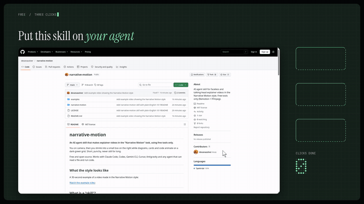

# story-motion

**An AI agent skill that makes explainer videos in the "Story Motion" look, using free tools only.**

You on camera, then you shrink into a small box on the right while diagrams, cards and code animate on a dark-green grid. Short, punchy, never still for long.

Free and open source. Works with Claude Code, Codex, Gemini CLI, Cursor, Antigravity and any agent that can read a file and run code.

---

## What the style looks like

A 30-second example of a video made in the Story Motion style:

[](https://devanasolver.github.io/story-motion/)

**[Play the full 30-second video](https://devanasolver.github.io/story-motion/)** (plays in the browser, no download)

Made by Anas. More on YouTube: **[Anas | Build Online](https://www.youtube.com/@anasstyb)**

Style inspired by [Payton Bilodeau](https://www.youtube.com/@paytonbilodeau) and his video [How To Steal Any Editing Style With AI (properly)](https://youtu.be/wsTL-VyyVIk). Not affiliated with him.

---

## How to install and use it (video)

A 20-second walkthrough: open the skill folder on GitHub, open `SKILL.md`, copy the raw file into your agent's skills folder.

[](https://devanasolver.github.io/story-motion/#tutorial)

**[Play the how-to video](https://devanasolver.github.io/story-motion/#tutorial)** (plays in the browser, no download)

---

## What is a "skill"?

A skill is a folder with a `SKILL.md` file. It is a recipe written for an AI coding agent. You do not run it yourself. You install the folder, then tell your agent what video you want, and the agent follows the recipe.

This skill's recipe covers:

| Part | What it gives you |
|---|---|
| Layouts | 5 alternating layouts: full screen, you in a small box, split screens, card pop-ins with arrows, a diagonal light/dark wipe. Nothing sits still for more than about 2.5 seconds. |
| Look | Elegant serif headlines with 1-2 mint-green italic words, clean sans text, mono labels, LED dot-matrix numbers for big stats. |
| Audio | Breaths and pauses cut tight, voice made dry and loud-clean, **no background music**, only quiet tick and whoosh sounds on transitions. |
| Vertical | A 9:16 version for Shorts, Reels and TikTok. |
| Code kit | `story-motion/assets/kit.tsx`: ready Remotion (React) building blocks with the exact sizes, colors and timings. |
| Style spec | `story-motion/references/style_spec.json`: all the sizes, colors, fonts, timings and audio settings in one file. |

It does **not** generate a voice. You bring a recorded voice (your own mic, or a voice you made with any tool). The skill only cleans and times it.

## What you need (all free)

- An AI coding agent (any of the ones below, free tiers work)
- [Node.js](https://nodejs.org) 18 or newer (for Remotion)
- [FFmpeg](https://ffmpeg.org/download.html) (audio cleanup and final export)
- Remotion, installed by the agent through `npm` when needed. It is free for individuals and small teams. Check [remotion.dev/license](https://www.remotion.dev/license) if you are a larger company.
- A voice recording (`.wav` or `.mp3`). Optional: a recording of yourself for the "talking head" box.

No paid APIs. No subscriptions. Nothing in this repo calls a paid service.

---

## Install (pick your agent)

First, get the files:

```bash
git clone https://github.com/devanasolver/story-motion.git
cd story-motion
```

Then copy the `story-motion` folder to where your agent looks for skills.

### Claude Code

```bash
# for all your projects
mkdir -p ~/.claude/skills && cp -r story-motion ~/.claude/skills/

# or for one project only
mkdir -p .claude/skills && cp -r story-motion .claude/skills/
```

Restart Claude Code. It will pick the skill up when you mention "Story Motion" or ask for this style of video.

### Codex CLI

Codex reads project instructions from `AGENTS.md`. The simple, always-working way:

```bash
cp -r story-motion ./story-motion
echo 'For videos in the Story Motion style, read story-motion/SKILL.md first and follow it.' >> AGENTS.md
```

### Gemini CLI

Gemini CLI reads `GEMINI.md`:

```bash
cp -r story-motion ./story-motion
echo 'For videos in the Story Motion style, read story-motion/SKILL.md first and follow it.' >> GEMINI.md
```

### Cursor

```bash
cp -r story-motion ./story-motion
mkdir -p .cursor/rules
echo 'For videos in the Story Motion style, read story-motion/SKILL.md first and follow it.' > .cursor/rules/story-motion.mdc
```

(Open the file in Cursor and set the rule to "Agent requested" if you want it loaded only when relevant.)

### Antigravity, Windsurf, Cline, or any other agent

Skill formats differ between tools, and they change. The method that works everywhere:

1. Copy the `story-motion` folder into your project.
2. Start your prompt with:

> Read `story-motion/SKILL.md` and every file it points to. Follow it exactly for this video.

That is all. The skill is plain Markdown, TypeScript and JSON, so any agent can use it.

---

## Make your first video (101)

### 1. Prepare a voice file

Record yourself reading your script on your phone or PC mic. Quiet room, mic close to your mouth. Save as `voice.wav`. Put it in your project folder.

### 2. Tell the agent what you want

Open your agent in the project folder and paste a prompt like this:

```
Use the story-motion skill.
Make a 35-second vertical (9:16) reel about why people overspend on subscriptions.
Voice: ./voice.wav. No face, no talking head.
Clean the voice, cut the breaths, no music.
Every card, caption and sound effect must land on the spoken word it matches.
Free tools only: Remotion and FFmpeg. Export an mp4 to ./out/reel.mp4.
```

### 3. Review and ask for changes

Open the mp4. Then ask for fixes in plain words:

- "The third card shows up too late. Move it to the word 'budget'."
- "Make the headline smaller. It touches the edge."
- "Swap the mint highlight to the word 'free'."

### 4. Export

The agent runs Remotion and FFmpeg and writes the mp4. Done.

---

## Example prompts

**Faceless short (9:16)**
```
Use story-motion. 30-second faceless Short about "3 free tools to learn faster".
Voice in ./voice.wav. Dark grid theme. One big LED number on the hook.
```

**Talking-head tutorial (16:9)**
```
Use story-motion. Edit ./raw.mp4 (me talking to camera) into a 3-minute tutorial.
Cut every breath and long pause. Put me in the small right box when diagrams appear.
Add step cards for each step I say. No music.
```

**Clean up audio only**
```
Use story-motion, audio part only. Take ./raw.mp4, cut breaths and dead air,
make the voice loud and dry, export ./clean.mp4. Do not change the picture.
```

**Before / after story with the wipe**
```
Use story-motion. 20-second reel: "Before: messy workflow, After: one tool".
Use the diagonal light/dark wipe between the two halves.
```

**Product explainer**
```
Use story-motion. 45-second explainer for my app. Three feature cards with arrows,
one stat in LED dots, a code card showing the install command. Voice: ./voice.wav.
```

**Add captions and effects to an existing edit**
```
Use story-motion. Take ./edit.mp4 and add the serif headline style, mint highlight words
and quiet tick sounds on each card. Keep my cuts as they are.
```

**New topic, same look**
```
Read story-motion/references/style_spec.json, then build a video on the topic of
"how to start a newsletter" with a layout change every 3-4 seconds.
```

---

## Tips

- Give the agent your **script and voice file together**. Timing is built around the spoken words.
- Ask for **a 10-second test first**, check it, then ask for the full video.
- If the agent skips a rule, say: "Re-read story-motion/SKILL.md and fix it."
- Keep everything free: say "free tools only" in your prompt.
- Old or weak PC? Ask for 1080p at 30 fps and render in short pieces.

## What is inside

```
story-motion/
  SKILL.md                     the recipe your agent follows
  assets/kit.tsx               Remotion building blocks
  references/style_spec.json   sizes, colors, fonts, timings, audio settings
```

## Support the project

If this saved you time:

- Star the repo
- [Buy me a coffee](https://buymeacoffee.com/isaac49)
- Follow [@devanasolver](https://github.com/devanasolver) for more free tools

## License

MIT. Use it for anything.
